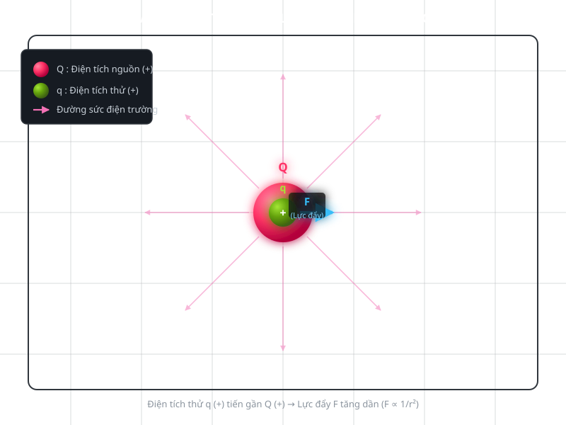
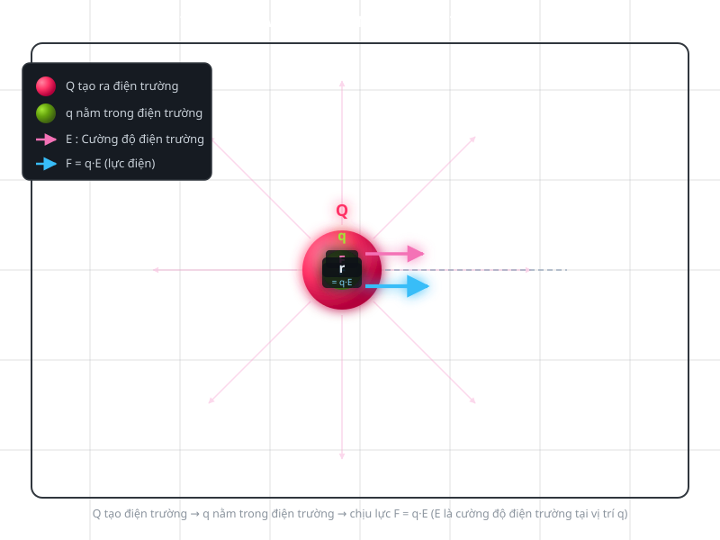

# Physic : Điện trường (electric field)

**index**

- [1.Điện trường](#1điện-trường)
	- [1.1.Bản chất vật lý của điện trường](#11bản-chất-vật-lý-của-điện-trường)
	- 1.2.Định nghĩa điện trường
	- 1.3.Vectơ cường độ điện trường
	- 1.4.Quan hệ giữa lực điện và điện trường
	- 1.5.Điện trường của điện tích điểm

---

## 1.Điện trường

<table>
<tr>
<td>
	<kbd>
	
	</kbd>
</td>
<td>

Điện trường là một dạng vật chất tồn tại xung quanh điện tích và có khả năng tác dụng lực điện lên các điện tích khác đặt trong nó. **Ví dụ**, đặt một điện tích dương $$\large Q$$ trong không gian. Khi đưa một điện tích thử $$\large q$$ đến gần $$\large Q$$, điện tích thử có thể chịu lực đẩy hoặc lực hút tùy theo dấu của hai điện tích.

</td>
</tr>
</table>

> [!IMPORTANT]
> **Điều quan trọng là:** ngay cả khi chưa có điện tích thử, điện trường vẫn có thể tồn tại xung quanh điện tích nguồn $$\large Q$$. Điện tích thử chỉ giúp chúng ta phát hiện và khảo sát điện trường đó.

### 1.1.Bản chất vật lý của điện trường

chúng ta cần phải hiểu 3 vấn đề để hiểu bản chất :
- 1. **điện trường ko đơn thuần là một vùng không gian:** Không gian xung quanh điện tích không chỉ là khoảng trống hình học. Điện tích nguồn làm xuất hiện một trạng thái vật lý có khả năng gây ra tương tác điện lên những điện tích khác. Trong vật lý cổ điển, ta mô tả trạng thái đó bằng đại lượng vectơ cường độ điện trường $$\large\vec{E}$$
- 2. **Điện trường là môi trường truyền tương tác điện:** Giả sử có hai điện tích $$\large Q$$ và $$\large q$$ cách nhau một khoảng $$\large r$$ :
   - Điện tích $$\large Q$$ tạo ra điện trường xung quanh nó.
   - Điện tích $$\large q$$ nằm trong điện trường đó và chịu lực điện.
   - Lực điện tác dụng lên $$\large q$$ được xác định bằng cường độ điện trường tại vị trí của $$\large q$$.
  <table>
  <tr>
  <td>

	Mối quan hệ này được biểu diễn bằng công thức: $$\large\vec{F}=q\vec{E}$$. Trong đó:
	- $$\large\vec{F}$$: lực điện tác dụng lên điện tích thử, đơn vị newton (N).
	- $$\large q$$: giá trị đại số của điện tích thử, đơn vị coulomb (C).
	- $$\large\vec{E}$$: cường độ điện trường tại vị trí đặt điện tích thử, đơn vị N/C hoặc V/m.
	Công thức cho thấy điện trường quyết định lực điện tác dụng lên một điện tích đã biết tại vị trí xác định.

  </td>

  <td>
	
  </td>
  </tr>
  </table>

> [!NOTE]
> **lưu ý:** nếu $$\large q > 0$$ thì lực điện cùng chiều $$\large\vec{E}$$, nếu $$\large q < 0$$ thì lực điện ngược chiều $$\large\vec{E}$$
- 3. **Điện trường có tính chất vật lý, không phải một công cụ toán học thuần túy:** Trong điện từ học cổ điển, điện trường là một đại lượng vật lý có thể được đo gián tiếp thông qua lực điện tác dụng lên điện tích thử. Nó có thể thay đổi theo thời gian, mang năng lượng và tương tác với vật chất. Điện trường cũng không cần có một môi trường vật chất như không khí để tồn tại. Nó có thể tồn tại trong chân không.